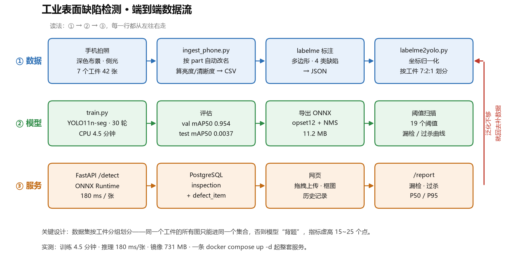
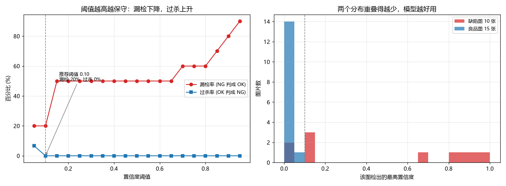

# 工业表面缺陷检测 · 端到端 Demo

用一台没有独显的笔记本，从零做一套能跑的工业视觉质检系统：
**手机拍 → 标注 → 训练 → 导出 ONNX → FastAPI 服务 → PostgreSQL 落库 → 网页演示**。

全部在 CPU 上跑通，不依赖 GPU、不依赖付费数据集、不需要开发板。



---

## 这个项目在解决什么

产线上的表面缺陷检测（划痕、脏污、缺件、变形）目前两条路：

| 做法 | 问题 |
|---|---|
| 人工目检 | 漏检率随疲劳上升，夜班更严重，招工越来越难 |
| 传统机器视觉（阈值 + 形态学） | 换个光照、换批材料就得重新调参数，维护成本高 |

深度学习路线的问题是**落地门槛**：要标注、要训练、要部署、要跟产线的 MES/数据库对接。
这个项目把整条链路走通了一遍，并且把**每一步的取舍和踩坑都记录了**。

不是"跑了个 YOLO demo"，而是：**数据怎么采、指标怎么看、阈值怎么定、服务怎么部署、性能瓶颈在哪。**

---

## 结果（如实汇报）

### 模型指标

| 评估集合 | seg mAP50 | mAP50-95 | 说明 |
|---|---|---|---|
| val（5 良品 + 5 划痕） | **0.954** | 0.431 | 划痕类，训练见过同类工件 |
| test（10 良品 + 5 撕角） | **0.0037** | 0.0005 | 撕角类，训练时一个都没见过 |

**这个差距不是 bug，是数据量的直接后果。** 42 张图、7 个工件，模型学到的是"p002 那张纸上的划痕长什么样"，而不是"什么是划痕"。

### 阈值扫描（产线语言）



| 评估集合 | 推荐阈值 | 漏检率 | 过杀率 | 准确率 |
|---|---|---|---|---|
| val | 0.05 | 0% | 0% | 100% |
| val + test | 0.10 | **20%** | 0% | 92% |

右图的分数分布揭示了原因：良品 15 张最高分全部 ≤ 0.079，划痕能到 0.96（分得开），**撕角只有 0.014–0.15（和良品重叠，分不开）**。

选阈值的规则：**漏检率不超过 5% 的前提下，取过杀率最低**。因为漏检的代价是缺陷流到客户手上，过杀的代价只是多看一眼，两者不对等。

### 服务性能

| 指标 | 数值 |
|---|---|
| 单次检测延迟（容器内 p50） | **180 ms** |
| 单次检测延迟（本机直跑） | 173–200 ms |
| ONNX 模型体积 | 11.2 MB |
| 镜像体积 | 731 MB |
| 首次构建 | 665 s（受网速影响） |
| 改代码后重建 | 约 10 s（依赖层被缓存） |

---

## 快速开始

### 方式一：Docker（一条命令）

```powershell
docker compose up -d --build
```

等 15 秒，打开 **http://127.0.0.1:8010/**

数据库密码等配置从 `.env` 读（不写死在 compose 文件里）。
需要改的话：`Copy-Item .env.example .env` 然后编辑；**不建 `.env` 也能跑**，每项都有默认值。

### 方式二：本机直跑（开发调试用）

```powershell
python -m pip install -r requirements.txt
python -m uvicorn src.service.main:app --port 8000
```

打开 **http://127.0.0.1:8000/**

### 跑测试

```powershell
python -m pip install -r requirements-dev.txt
python -m pytest tests -q
```

9 个用例，覆盖健康检查、页面、空文件 / 非图片 / 超大文件三种拒绝路径、落库后能查回来、404。
**不依赖真模型**（没有 `models/best.onnx` 时自动退回 MockDetector），也不写脏你的真实数据
（测试自己建临时目录和临时 SQLite）。

### 验证没吹牛

```powershell
# 1. 服务活着吗
curl http://127.0.0.1:8000/health

# 2. 推一张缺陷图，看返回几个框
curl -X POST -F "file=@data/yolo/images/val/card_p004_scratch_001.jpg" http://127.0.0.1:8000/detect

# 3. 复现训练
python src/train/train.py --epochs 30 --imgsz 640 --batch 4 --name baseline_v1

# 4. 复现阈值扫描
python src/eval/threshold_sweep.py
```

---

## 目录结构

```
defect-vision/
├── src/
│   ├── capture/grab.py          # 摄像头采集（带曝光/对焦锁定、亮度告警、断点续采）
│   ├── data/
│   │   ├── ingest_phone.py      # 手机照片批量入库：改名、算亮度/清晰度、写 metadata.csv
│   │   ├── labelme2yolo.py      # labelme 多边形 JSON → YOLO-seg txt
│   │   ├── import_labels.py     # 标注结果按划分送回对应目录
│   │   ├── prepare.py           # 按工件分组划分 7:2:1，生成 YOLO 目录结构
│   │   └── check_labels.py      # 标注格式体检（类别号、点数、归一化范围）
│   ├── train/train.py           # 训练 + 评估，逐类输出 mAP
│   ├── eval/
│   │   ├── threshold_sweep.py   # 阈值扫描：漏检率/过杀率曲线
│   │   └── quant_compare.py     # 量化前后逐图对比（框数/置信度/判定一致性）
│   ├── deploy/quantize.py       # INT8 量化：动态 / 静态全算子 / 静态仅 Conv
│   ├── service/
│   │   ├── main.py              # FastAPI：/detect /records /report /health
│   │   ├── detector.py          # ONNX Runtime 推理 + letterbox 预处理
│   │   ├── db.py                # SQLAlchemy 模型 + 幂等迁移
│   │   └── static/index.html    # 单文件前端，无构建
│   └── cpp/                     # C++ 推理示例（规划中）
├── tests/
│   ├── conftest.py              # 临时库 + 临时上传目录 + 强制 Mock 模型
│   └── test_api.py              # 9 个接口回归用例
├── data/yolo/data.yaml          # 数据集配置（由 prepare.py 生成）
├── docker-compose.yml           # 应用 + PostgreSQL 一键启动
├── Dockerfile
├── .env.example                 # 配置模板（真实密码放 .env，不进 git）
├── requirements.txt             # 运行时依赖
├── requirements-dev.txt         # 仅开发/测试：pytest + httpx
├── LICENSE                      # MIT
├── docs/
│   ├── 运行手册.md              # 所有命令、报错速查、进度记录
│   ├── 采集操作手册.md          # 怎么拍出能用的图
│   ├── 标注规范.md              # 4 类缺陷的判定边界
│   ├── 演示脚本.md              # 3 分钟演示分镜 + 追问应对
│   ├── 简历与面试材料.md        # 简历三条 + 8 个数字 + 高频追问
│   └── 错题本.md                # 42 条踩坑记录（按天编号，每条含现象/原因/解法）
└── reports/                     # 指标、曲线、分析报告
    ├── baseline_v1_分析.md      # 训练结果与失败归因
    ├── 阈值扫描.md              # 漏检/过杀权衡曲线
    └── 量化对比.md              # INT8 三种方案实测
```

---

## 关键设计决策

这一节是给面试官看的：**为什么这么做，不这么做会怎样。**

### 1. 数据集按「工件」分组划分，不是随机划分

同一个工件的 30 张照片长得几乎一样（位置、纹理、折痕都相同）。如果按图片随机划分，验证集里会出现和训练集同一张纸的照片——**模型在"背题"**。

实测代价：随机划分会让指标虚高 **15–25 个点**，上线后断崖式下跌。

做法：文件名里带 `_p001_` 作为工件号，划分时整组进同一个集合，`prepare.py` 会校验每个集合里既有良品也有缺陷。

### 2. 良品必须有「空 txt 文件」

YOLO 会把没有 txt 的图当作"未标注"直接丢弃。良品图只有一张空 txt 才算"我确认这里没有缺陷"。

这个坑导致过一整批良品图被静默忽略——训练时良品数量为 0，模型会把所有东西都判成缺陷。

### 3. 导出 ONNX 时就把 NMS 固化进去

第一版在 Python 里做后处理，同一个缺陷被框了两次（IoU 0.611，而默认 NMS 阈值是 0.7）。

改成导出参数 `nms=True, iou=0.5` 后，缺陷数 6→5，重复框消失。

**这不是"调参提指标"**：调后处理不改变模型能力，只改变"一个缺陷算一个还是算两个"。把它说成提指标就是自欺欺人。

### 4. 用命名卷，不用 Windows 目录绑定

第一版把上传目录挂到宿主机：

```yaml
volumes:
  - ./data/uploads_docker:/app/data/uploads
```

单次检测 **1403 ms**。逐段计时定位：

| 环节 | 耗时 |
|---|---|
| 解码 2.8 MB JPEG | 161 ms |
| 缩放到 640×640 | 3 ms |
| **ONNX 推理** | **39 ms** |
| 写容器内盘 | 28 ms |
| 写绑定的 Windows 目录 | **1219 ms** |

Docker Desktop 在 Windows 上走 9p/virtiofs 转发，小文件写入被放大几十倍。换成命名卷后 **1403 ms → 180 ms**。

**先测量，再动手。** 90% 的人会去调模型参数，然后发现没用。

### 5. 阈值扫描而不是固定 conf=0.25

YOLO 默认 `conf=0.25` 是给通用目标检测的。工业场景必须扫出一条"阈值 vs 漏检率/过杀率"曲线，再由业务定阈值。

脚本技巧：**推理只跑一次**。先按 `conf=0.01` 取出所有框，记下每张图的最大置信度；之后 19 个阈值只是拿这个分数比大小。42 张 × 19 = 798 次推理变成 42 次。

### 6. 上传大小「边读边拦」，不是读完再判断

```python
raw = await file.read()                    # ❌ 常见写法
if len(raw) > LIMIT: raise 413
```

上面这段看着像做了限制，其实**没做**：`read()` 会先把整个文件读进内存，别人传 2 GB，进程先吃掉 2 GB 才回一个 413。

正确做法是两道闸：先看 `Content-Length`（便宜但客户端会撒谎），再 64 KB 一块循环读、边读边累加，超了立刻停。

### 7. 有回归测试，且不依赖真模型

`tests/` 下 9 个 pytest 用例，覆盖健康检查、页面、三种拒绝路径（空文件 / 非图片 / 超大）、落库后能查回来、404。

两个设计点：
- **不依赖 `models/best.onnx`**：测试里把模型路径指到不存在的文件，服务自动退回 MockDetector —— 别人 clone 下来不用先下权重就能跑测试
- **不写脏真实数据**：测试自己在临时目录建 SQLite 和上传目录

写这批测试时抓到一个真 bug：`path.relative_to(BASE_DIR)` 在上传目录被指到项目外时会抛 `ValueError` → 500。这是纯靠读代码看不出来的。

---

## 已知限制

写下来是为了显示我知道边界在哪：

| 限制 | 影响 | 改进方向 |
|---|---|---|
| 只有 42 张图 / 7 个工件 | 换工件就失效 | 补到 200+ 张、20+ 工件 |
| 只有一种光照（侧光） | 换光源模型大概率崩 | 补顶光/背光两组，做光源对比实验 |
| 训练和测试用同一台手机 | 换设备有域偏移风险 | 换相机后重训，或做颜色归一化 |
| 没做无监督异常检测 | 新缺陷类型要靠人工补标 | 加 PatchCore / EfficientAD 做兜底 |
| INT8 在这台机器不提速 | 静态量化 1.28×，仅 Conv 只有 1.23× | x86 无 VNNI 时量化收益有限，真收益在 ARM NPU |
| 前端是单文件 HTML | 不能多人协作 | Vue/React + 构建流程 |

---

## 技术栈

| 层 | 选型 |
|---|---|
| 采集 | OpenCV（曝光/对焦锁定、Laplacian 清晰度检测、亮度漂移告警） |
| 标注 | labelme（多边形，支持导出 YOLO Segmentation） |
| 训练 | Ultralytics YOLO11n-seg（2.88 M 参数） |
| 推理 | ONNX Runtime CPU（opset 12，导出时固化 NMS） |
| 服务 | FastAPI + Uvicorn |
| 数据库 | PostgreSQL 17（inspection / defect_item，外键级联删除） |
| 部署 | Docker + Docker Compose |
| 环境 | Python 3.11 / Windows 11 / 20 核 CPU / 无独显 |

---

## 后续计划

- [ ] 数据补到 200 张、20 个工件，重训看 test 能否 > 0.5
- [ ] 补顶光、背光两组，做「光源 × 模型」指标矩阵
- [ ] 加无监督异常检测（PatchCore）作为未知缺陷兜底
- [x] ONNX INT8 量化，对比精度损失与加速比（见 [量化对比](reports/量化对比.md)）
- [ ] 用 PyAV 替换 `cv2.VideoCapture`，做 RTSP 实时检测（丢帧只留最新帧）

---

## 参考

- [标注意见与判定边界](docs/标注规范.md)
- [采集操作手册](docs/采集操作手册.md)
- [运行手册（所有命令在这里）](docs/运行手册.md)
- [错题本（42 条踩坑记录）](docs/错题本.md)
- [训练结果分析](reports/baseline_v1_分析.md)
- [阈值扫描结论](reports/threshold_sweep.md)
- [INT8 量化对比](reports/量化对比.md)
