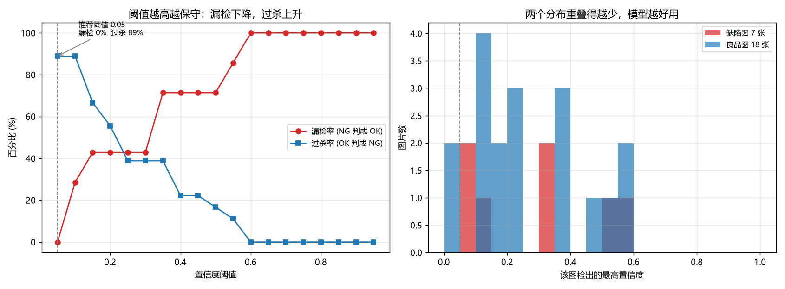

# 阈值扫描结论

- 样本：25 张（缺陷 7 张、良品 18 张），集合 val, test
- 模型：`runs/segment/baseline_v1/weights/best.pt`
- 推荐阈值：**0.05**
- 该阈值下：漏检 **0%**，过杀 **89%**，准确率 36%

选阈值的规则：漏检率不超过 5% 的前提下，取过杀率最低。
理由：漏检的代价是缺陷流到客户手上，过杀的代价是多看两眼，两者不对等。

