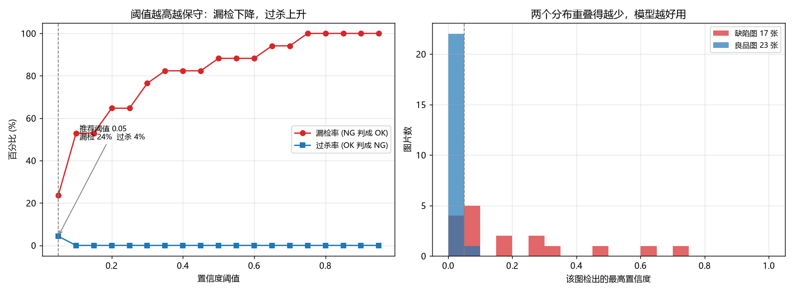

> ⚠ **本报告已作废（2026-11-17 审计）**
> 原因：脚本当时把模型路径写死成 `baseline_v1`，没记录实际加载的权重与 imgsz，无法追溯。
> 实测复现证明：其中「漏检 24%、过杀 4%」那一份，是 **baseline_v1 权重**在 `val test` + `1280` 下跑出来的，
> 并非 v4。以 `threshold_sweep_v4_val.md`（选阈值）与 `threshold_sweep_v4_test.md`（独立验证）为准。
# 阈值扫描结论

- 样本：40 张（缺陷 17 张、良品 23 张），集合 val, test
- 模型：`runs/segment/baseline_v1/weights/best.pt`
- 推荐阈值：**0.05**
- 该阈值下：漏检 **24%**，过杀 **4%**，准确率 88%

选阈值的规则：漏检率不超过 5% 的前提下，取过杀率最低。
理由：漏检的代价是缺陷流到客户手上，过杀的代价是多看两眼，两者不对等。

