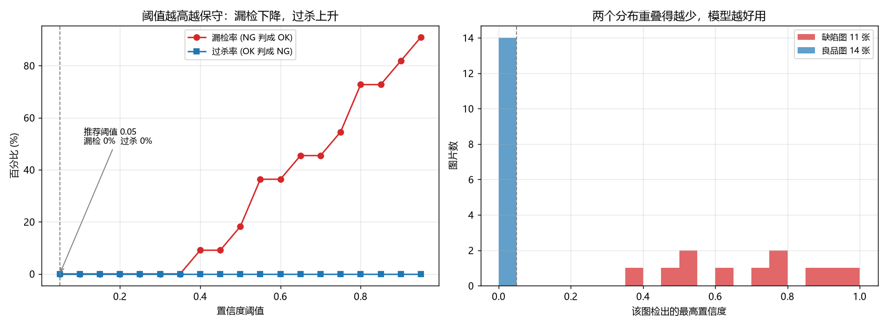

# 阈值扫描结论

- 生成时间：2026-11-17 14:56:58
- 模型：`runs/segment/baseline_v4/weights/best.pt`
- 推理尺寸：**1280**
- 集合：val（共 25 张：缺陷 11 张、良品 14 张）
- 推荐阈值：**0.05**
- 该阈值下：漏检 **0%**，过杀 **0%**，准确率 100%

选阈值的规则：漏检率不超过 5% 的前提下，取过杀率最低。
理由：漏检的代价是缺陷流到客户手上，过杀的代价是多看两眼，两者不对等。

> 口径提醒：上面所有指标都是在 `val` 上算出来的。
> test 未参与选阈值，可单独作为独立验证。
> 复现命令：`python src/eval/threshold_sweep.py --splits val --imgsz 1280 --model runs/segment/baseline_v4/weights/best.pt --tag _v4_val`

